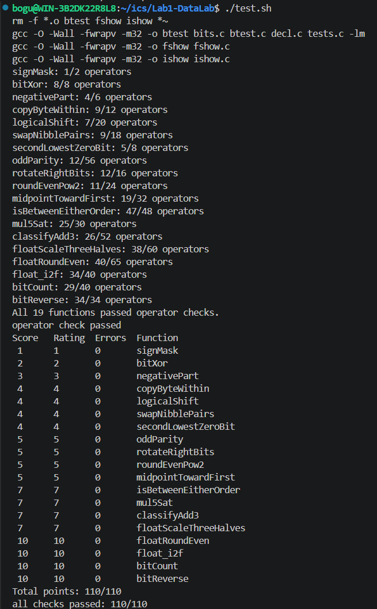

- [ ] # Lab1 DataLab 实验报告

  姓名：杜泊谷
  学号：24300240216

  ## 一、各题实现思路

  ### P1 `signMask`

  将 `1` 左移 31 位。

  ### P2 `bitXor`

  异或可以表示为 `(x & ~y) | (~x & y)`，由于题目禁止使用 `|`，再利用德摩根律 `a | b = ~(~a & ~b)`，最终使用 `~` 和 `&` 实现：
  `~(~(x & ~y) & ~(~x & y))`。

  ### P3 `negativePart`

  利用算术右移 `x >> 31` 得到符号掩码：非负数得到全 0，负数得到全 1；再用补码公式 `-x = ~x + 1`，因此通过 `(~x + 1) & (x >> 31)` 实现负数返回相反数、非负数返回 0。

  ### P4 `copyByteWithin`

  先用 `(x >> (src << 3)) & 0xFF` 提取第 `src` 个字节；再用 `~(0xFF << (dst << 3))` 清空第 `dst` 个字节，最后将源字节左移到目标位置并通过 `|` 与原数重新组合。

  ### P5 `logicalShift`

  先执行 `x >> n` 得到算术右移结果，再构造左侧 `n` 位为 0、其余位为 1 的 mask，与右移结果进行 `&`，从而清除负数算术右移时补入的符号位，实现逻辑右移。

  ### P6 `swapNibblePairs`

  构造 `0x0F0F0F0F` 掩码，用 `(x & mask) << 4` 将每个字节的低 4 位移到高 4 位，再用 `(x >> 4) & mask` 将高 4 位移到低 4 位，最后将两部分按位或。

  ### P7 `secondLowestZeroBit`

  先使用 `y = x | (x + 1)` 将 `x` 中最低的 0 变成 1，此时原来的第二低 0 就成为 `y` 的最低 0；再使用 `~y & (y + 1)` 提取该位置。

  ### P8 `oddParity`

  不断执行 `x ^= x >> 16`、`x ^= x >> 8`、`x ^= x >> 4`、`x ^= x >> 2`、`x ^= x >> 1`，将全部 32 位的异或结果折叠到最低位；最低位为 0 说明 1 的数量为偶数，因此最后返回 `!(x & 1)`。

  ### P9 `rotateRightBits`

  先用 `n & 31` 得到实际循环位数，将 `x` 逻辑右移 `n` 位得到右半部分，同时将 `x` 左移 `32-n` 位得到被移出去的低位部分，再通过按位或将两部分合并，得到循环右移结果。

  ### P10 `roundEvenPow2`

  先计算 `q = x >> n`，再构造舍入偏置 `2^(n-1)-1+(q&1)`；当恰好位于两个 `2^n` 倍数之间时，`q&1` 决定是否向上进位，从而保证最终商为偶数，最后通过右移再左移 `n` 位得到结果。

  ### P11 `midpointTowardFirst`

  使用 `(x & y) + ((x ^ y) >> 1)` 求中点，避免直接计算 `x+y` 导致溢出；若 `x` 和 `y` 一奇一偶，则中点含有 `.5`，此时再根据 `x` 与 `y` 的大小决定是否在结果上加 1，使结果向第一个参数 `x` 靠近。

  ### P12 `isBetweenEitherOrder`

  分别判断 `a <= x <= b` 和 `b <= x <= a`。比较两个整数时，先根据符号位处理异号情况；同号时利用 `q + (~p + 1)` 即 `q-p` 的符号判断 `p <= q`，最后将两种端点顺序的判断结果组合。

  ### P13 `mul5Sat`

  使用 `(x << 2) + x` 实现 `x*5`。通过检查 `(x << 2) >> 2` 是否仍等于原来的 `x` 判断左移是否溢出，同时根据同号数相加后符号是否改变判断加法溢出；若溢出，则根据原 `x` 的符号返回 `INT_MAX` 或 `INT_MIN`。

  ### P14 `classifyAdd3`

  先计算 `x+y`，通过两个操作数和结果的符号判断第一次加法是正溢出、负溢出还是不溢出；再将中间结果与 `z` 相加并进行相同判断，将两次溢出的方向分别编码为 `1`、`-1` 或 `0`，组合后得到最终分类结果。

  ### P15 `floatScaleThreeHalves`

  先通过位运算从 `uf` 中取出 `sign`、`exp` 和 `frac`。对于 NaN 和无穷直接返回原值；非规格化数直接对尾数计算 `3/2`；规格化数先补上隐藏的最高位 `1`，计算 `3/2` 后根据结果调整阶码，并按照 round-to-nearest-even 规则处理被舍弃的低位。

  ### P16 `floatRoundEven`

  先拆出符号位、阶码和 fraction，并计算真实指数 `e = exp - 127`。当 `e < -1` 时结果直接为带原符号的 0，`e == -1` 时单独处理 `0.5` 附近的情况，`e >= 23` 时原数已经没有小数部分；其他情况根据需要删除的 fraction 位计算 `remainder` 和 `half`，按照“小于一半舍、大于一半入、等于一半取偶数”完成舍入。

  ### P17 `float_i2f`

  先记录整数符号并取得绝对值，然后寻找最高位 `1` 的位置 `p`，由 `p + 127` 得到 Float32 的 exponent。若有效位数不超过 24 位，则直接左移得到 fraction；否则右移保留最高 24 位，并根据被舍弃部分按照 round-to-nearest-even 进行舍入，最后拼接 `sign`、`exp` 和 `frac`。

  ### P18 `bitCount`

  先使用 `0x55555555` 将相邻两位中的 1 数量相加，再使用 `0x33333333` 合并为每 4 位的计数，使用 `0x0F0F0F0F` 合并为每 8 位的计数；之后继续通过右移 8 位和 16 位进行累加，最终最低几位就是整个 32 位整数中 1 的数量。

  ### P19 `bitReverse`

  通过分治方式逐层交换 bit：首先使用 `0x55555555` 交换相邻 1 位，然后使用 `0x33333333` 交换相邻 2 位，再依次交换 4 位、8 位和 16 位块；经过五轮交换后，原来的 bit31 到 bit0 正好全部反序排列。

  ## 二、测试结果

  

  ## 三、实验总结

  通过本次实验，我进一步理解了补码、算术移位、掩码、整数溢出等位级运算方法，同时通过浮点题熟悉了 IEEE 754 单精度浮点数中符号位、阶码和尾数的表示方式，以及 round-to-nearest-even 舍入规则。
